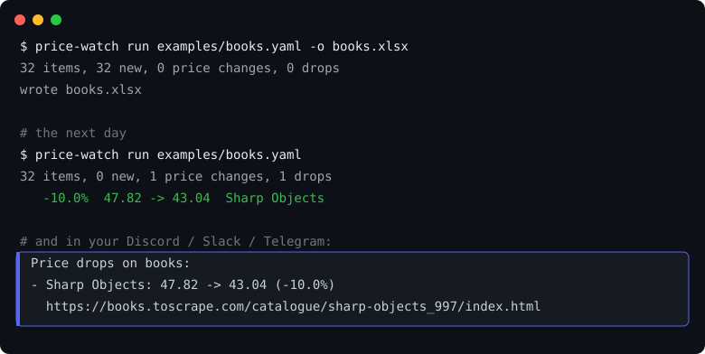

# price-watch

[](https://github.com/saiv0n/price-watch/actions/workflows/ci.yml)


Scrape product listings from online shops into Excel, CSV, JSON or Google Sheets, keep a price history, and get a Discord, Slack or Telegram message when something gets cheaper.

Each site is one small YAML file. Adding a new shop means writing a few CSS selectors, not code.

<p align="center"></p>

## What you get

This is a real run of [examples/books.yaml](examples/books.yaml) (the full file is in [data/books.csv](data/books.csv), refreshed daily by GitHub Actions):

| title | price | in_stock | rating | upc | stock | category |
|---|---|---|---|---|---|---|
| Sharp Objects | 47.82 | True | 4 | e00eb4fd7b871a48 | 20 | Mystery |
| In a Dark, Dark Wood | 19.63 | True | 1 | 19ed25f4641d5efd | 18 | Mystery |
| The Past Never Ends | 56.50 | True | 4 | 5ee94540d0749ea0 | 16 | Mystery |

The listing pages give title, price, rating and stock status. The tool then opens every product page for the UPC, exact stock count, category and description, and merges both into one row.

## Features

- Listing pages with pagination, plus optional product detail pages merged into the same row
- Shopify stores read straight from their JSON catalogue, no selectors needed
- Prices parsed in any common format: `£51.77`, `$1,299.00`, `1.299,90 TL`, `12 499 ₽`, `CHF 1'250.50`
- Price history in SQLite, with new products and price changes reported on every run
- Alerts to Discord, Slack or Telegram above a drop threshold you choose
- Export to Excel (frozen header, filters, sized columns), CSV that opens cleanly in Excel, JSON, or a Google Sheet
- Polite crawling: delay between requests, retries with backoff on 429 and 5xx, `Retry-After`, robots.txt
- JavaScript-heavy shops through headless Chromium
- Runs on a schedule for free with the included GitHub Actions workflow

## Install

```bash
git clone https://github.com/saiv0n/price-watch
cd price-watch
pip install .
```

Optional extras:

```bash
pip install '.[js]' && playwright install chromium   # JavaScript-rendered shops
pip install '.[sheets]'                              # Google Sheets output
```

## Quick start

```bash
price-watch test examples/books.yaml -n 1     # check what the selectors pick up
price-watch run examples/books.yaml -o books.xlsx
```

`test` fetches one page, prints the first items and warns about fields that came back empty, so you can fix selectors before a long crawl.

## Configure a site

```yaml
name: books
start_url: https://books.toscrape.com/catalogue/category/books/mystery_3/index.html
item: article.product_pod        # one match per product
key: url                         # identifies a product between runs
next_page: li.next a

fields:
  title: {css: h3 a, attr: title}
  url:   {css: h3 a, attr: href, type: url}
  price: {css: .price_color, type: price}
  rating:
    css: p.star-rating
    attr: class
    re: "(One|Two|Three|Four|Five)"
    map: {One: 1, Two: 2, Three: 3, Four: 4, Five: 5}

detail:                          # optional: visit each product page too
  url_field: url
  fields:
    upc: "table.table-striped tr:nth-of-type(1) td"
    stock: {css: .product_main .availability, re: "(\\d+) available", type: int}

alerts:
  drop_percent: 5                # alert only on drops of 5% or more

notify:
  webhook: ${PRICE_WATCH_WEBHOOK}
```

A field is a CSS selector, optionally with `attr` (read an attribute instead of the text), `re` (keep the first regex group), `map` (translate values), `default`, and a `type` of `text`, `price`, `int`, `url` or `bool`. `title: h1` is shorthand for `{css: h1}`.

Other options: `start_urls` (a list), `max_pages`, `delay`, `timeout`, `user_agent`, `respect_robots`, `render_js`.

A product page that fails to load keeps its listing data and gets an `error` column instead of stopping the crawl.

## Shopify stores

```yaml
name: my-shop
source: shopify
start_url: https://store.example.com/collections/sale   # or the shop root for everything
```

This reads `/products.json` page by page and returns title, url, lowest price, compare-at price, whether it is on sale, availability, vendor, product type, SKU, variant count and image.

## Google Sheets

Create a service account in Google Cloud, share the sheet with its email, then:

```bash
export GOOGLE_SERVICE_ACCOUNT=/path/to/service-account.json
price-watch run mysite.yaml -o sheets:<spreadsheet-id>/prices
```

The `prices` tab is replaced with the latest run and created if missing.

## Commands

```bash
price-watch run CONFIG [-o OUT]           # crawl, store, alert, optionally export
price-watch test CONFIG [--url URL]       # dry run on one page
price-watch export CONFIG OUT             # export the last stored run
price-watch history CONFIG ITEM_URL       # price history of one product
```

`OUT` is a `.xlsx`, `.csv` or `.json` path, or `sheets:<id>[/<tab>]`. `--db path` picks the SQLite file (default `price-watch.db`) and `-v` logs every page.

## Alerts

```bash
export PRICE_WATCH_WEBHOOK=https://discord.com/api/webhooks/...   # or a Slack incoming webhook
export TELEGRAM_TOKEN=123456:ABC...
export TELEGRAM_CHAT_ID=123456789
```

Secrets are read from the environment, so config files can be committed safely. A failing webhook is logged and never loses the crawl that was just saved.

## Run it on a schedule

[.github/workflows/crawl.yml](.github/workflows/crawl.yml) crawls once a day on GitHub's servers and commits the results to `data/`. Fork the repo, point it at your own config, and add `PRICE_WATCH_WEBHOOK` under Settings, Secrets to get alerts. No server needed.

On your own machine, cron works too:

```
0 */6 * * * cd /path/to/price-watch && price-watch run mysite.yaml -o latest.xlsx
```

## Tests

```bash
uv run pytest
```

30 tests run offline against saved pages and mocked HTTP: price parsing across locales, pagination, detail pages, Shopify, change detection, every export format, retries, robots.txt, and a full two-run session that ends in a webhook alert.

## Scraping responsibly

The example targets books.toscrape.com, a site built for scraping practice. For real shops, check their terms, keep the delay reasonable and leave `respect_robots` on.

## License

MIT
